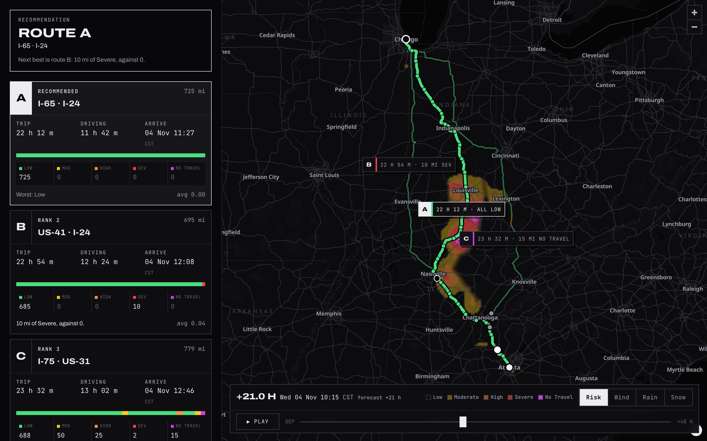

# Squall Line

Weather-aware truck routing. Give it an origin, a destination, a departure time and the load, and it returns
three truck routes, the forecast at every checkpoint **at the moment the truck gets there**, the miles each route
spends at each risk level, a recommendation that says why, and a 48-hour weather heatmap over the whole corridor.

**Live:** <https://squall-line.vercel.app> · **Recorded storm:** <https://squall-line.vercel.app/?demo=storm> (a real plan kept for calm days, [below](#a-recorded-storm))



- Django 6.1 + django-ninja API, NumPy for the array work; React 19, TypeScript 7, Vite 8, MapLibre GL 6,
  Tailwind 4, TanStack Query, Zustand and Zod in the browser.
- Truck routing from TomTom (weight, governed speed and truck restrictions), with keyless Valhalla and OSRM
  fallbacks; forecasts from Open-Meteo (NOAA HRRR for the first 48 hours over the US).
- 231 backend tests (96% branch coverage, mypy strict), 55 unit and component tests and 26 Playwright end-to-end runs
  (desktop and phone) in the browser.

## Running it

You need Python 3.14 with [uv](https://docs.astral.sh/uv/), and Node 22 or later. A TomTom key is optional: without
one the keyless public Valhalla and OSRM servers route the trucks and Photon searches places.

```bash
cp .env.example .env              # optional: TOMTOM_API_KEY=...

cd backend
uv sync                           # Django, ninja, httpx, NumPy, tzfpy, and the dev tools
uv run python manage.py runserver # API on http://127.0.0.1:8000/api/

cd ../frontend
npm ci
npm run dev                       # http://127.0.0.1:5173, /api proxied to Django
```

Django reads `.env` at the repository root itself (variables already in the environment win). `npm run build` writes `frontend/dist/`, and Django
then serves the app as well, so `runserver` alone is enough to try the production build. Interactive API docs are
at `/api/docs`.

### Tests

```bash
cd backend && uv run pytest && uv run ruff check . && uv run mypy
cd frontend && npm run check && npm test && npm run test:e2e
```

Every backend test runs offline. The pipeline tests replay real recorded answers from the routing engines and
Open-Meteo (`backend/tests/fixtures/*.json.gz`, recorded by `tests/fixtures/record.py`), so the whole plan, from
routes to heatmap, is checked against real weather. The frontend fixtures are the backend's output for those same
recordings, and a backend test fails if they drift. The end-to-end tests run the production build in Chromium
against a mocked API and a mocked tile server, on a desktop viewport and a Pixel 7.

## How a plan is made

```
origin, destination, departure, load
  -> three truck routes                       routing.py
  -> checkpoints every 10, 25 or 50 miles      checkpoints.py
  -> the truck's arrival time at each          schedule.py   (driving time + hours-of-service stops)
  -> the forecast at that place and time       weather.py
  -> a risk level per checkpoint               risk.py
  -> miles at each level, ranking, reasons     scoring.py
  -> 49 hourly frames over the corridor        corridor.py
```

`service.py` runs the steps; `api.py` is the HTTP layer.

### Routes

TomTom's truck routing is asked for the fastest route and two alternatives, with the truck's weight (a 35,000 lb
tractor and dry van plus the load), its dimensions and a 65 mph governed speed. An alternative that shares 97% or
more of its road with a faster route is dropped. When fewer than three remain, more candidates come from routing
through a point to one side of the main route's midpoint, then the other side; a candidate is kept only if it
shares less than 80% of its road with the routes already chosen and takes at most 1.5 times as long. Two places
with only one or two reasonable roads between them get one or two routes, and the page says how many were found.

The routes for a trip are cached for six hours (by origin, destination, load to the nearest 1,000 lb and departure
hour). An answer that came from a fallback engine because the one before it failed, or that has fewer than three
routes because a request through a side point failed, is kept for ten minutes only.

### When the truck is where

Each checkpoint's arrival time is the departure, plus the driving time to it, plus the stops before it. Driving
time comes from the engine's own timing along the route (TomTom's per-instruction travel times, Valhalla's
maneuvers), spread over the road between them by distance. With hours of service on (the default), the federal
rules for a property-carrying driver (49 CFR 395.3) add a 30-minute break after 8 hours of driving and a 10-hour
rest after 11. The driver is assumed to start rested, with hours left in the week. The stops are drawn on the map
and listed between the checkpoints. Every route's checkpoints are drawn on the map too: the selected route's in
full, the others dimmed.

### The forecast at the truck's ETA

Open-Meteo's hourly fields are read the way they are defined: wind speed and temperature are instantaneous, so they
are interpolated between the hours on either side of the ETA; rain, showers, snowfall and gusts are totals or
maxima over the preceding hour, so the ETA takes the hour that contains it. Rain is `rain + showers`, and snowfall
in inches per hour is the unit the rules use. Wind is the sustained 10 m wind speed; gusts are shown but not
scored, because the rules are written for wind speed.

A plan asks Open-Meteo for at most 450 locations: every checkpoint of three routes plus the corridor heatmap. Long
trips at 10-mile spacing would ask for more, so points are snapped to a grid that coarsens until they fit
(`meta.weather_grid_deg` and `meta.weather_snapped` report what happened). Each location's series is cached for half
an hour by the server process that fetched it (shared by every process through Redis when `REDIS_URL` is set). A
later plan reuses a series for the same location when the series covers the hours that plan needs. So another load
costs no forecast request when its routes are the same; another interval moves the checkpoints and resizes the
corridor grid, so most of its locations are new; another departure is covered only if its window, from an hour
before the departure to two hours after the later of the last arrival and the 48-hour mark, lies inside the cached
one, which usually means a departure within the same hour.

### Risk

| Level | Wind (mph) | Rain (in/hr) | Snow (in/hr) |
|---|---|---|---|
| Low | < 25 | < 0.10 | < 0.5 |
| Moderate | 25 - 34 | 0.10 - 0.25 | 0.5 - 1.0 |
| High | 35 - 44 | 0.25 - 0.50 | 1.0 - 2.0 |
| Severe | 45 - 54 | 0.50 - 1.00 | 2.0 - 3.0 |
| No Travel | ≥ 55 | > 1.00 | > 3.0 |

Heavy loads raise the wind level: 45-54 mph with more than 30,000 lb on board is No Travel, and 35-44 mph with more
than 40,000 lb is Severe. The worst of the three conditions sets the checkpoint's level.

The bounds are kept exactly as the table writes them. Every band includes its lower bound, so 25 mph is Moderate and
0.25 in/hr is High. No Travel is "≥ 55" for wind but "> 1.00" and "> 3.0" for rain and snow, so 1.00 in/hr of rain
is still Severe and 55 mph of wind is already No Travel. Values are classified at the precision they are shown in:
the checkpoint table and the checkpoint card give wind to 0.1 mph and rain and snow to 0.001 in/hr, so a rain total
of 0.0999999 is the 0.100 the page displays. The server and the browser round the same way, half up on the float64
product (`Math.round(value * 10**decimals) / 10**decimals`), so 24.95 mph is 25.0 and Moderate in the checkpoints,
in the heatmap and in the numbers shown. A missing value is an error, never Low. The thresholds and load rules are
served at `/api/rules`, and the page draws its legend and the rules panel from that answer.

### Ranking

Each checkpoint stands for the road halfway to its neighbours, so the represented miles add up to the route's
length and the sampled levels become "miles at each level". Routes are ranked by:

1. fewest No Travel miles,
2. fewest Severe miles,
3. fewest High miles,
4. lowest average risk (the mile-weighted level, 0 for Low to 4 for No Travel),
5. shortest trip time.

Keys 2 to 5 are the stated order. No Travel miles come first because a route through No Travel weather cannot be
preferred to one without it, however the other keys compare. Miles are compared to a tenth of a mile, the average
to a hundredth and the trip time to the minute, the precision they are shown at, so the reason given for every
ranking (the first key on which the routes differ, shown on each card) can be read off the numbers on screen. Routes
that tie on every key keep the engine's order, and the card says the route ties the recommended one. On a calm day
every route is Low all the way and the fastest one wins. When every route meets No Travel weather, the plan still
ranks them and says that no route is safe.

### The corridor heatmap

The corridor is everything within a distance W of any of the three routes, where W is 4% of the longest route,
kept between 30 and 90 km. A regular grid in Web Mercator, the map's own projection, covers it. Its budget of cells
is what the 450 locations leave after the checkpoints, kept between 120 and 200, and the cell size is chosen so that
between 85% of the budget and the whole budget fall inside the corridor: as few as about 102 cells and at most 200,
each one a forecast location. The plan carries 49 hourly frames from the departure (hour 0 to hour 48) of wind,
rain, snow and risk for every cell.

In the browser the whole lattice is one image laid over the map by its four corners, so no cell is ever misplaced.
Each cell is drawn as 15 x 15 pixels, an odd number, so a pixel centre falls exactly on every cell centre: the
weather is interpolated in space between cell centres and in time between the hourly frames, and only then coloured.
The risk layer classifies the interpolated weather with the same published rules, so hazard areas grow, shrink and
drift as the clock moves instead of jumping hour by hour, and at every cell centre on every hour it is exactly the
level the server computed (a unit test checks every cell of every frame of a real stormy plan). The image's edge
follows the corridor around the routes, not the grid's staircase. Painting a frame takes about 3 ms (measured for
the Chicago to Atlanta corridor on a laptop), well inside a 60 Hz frame, so dragging or playing the clock stays
smooth; the trucks move along their routes with it.

### A recorded storm

The live map shows the weather that is actually coming, so on a calm day the risk layer is nearly empty. The app
also keeps one real plan, recorded on 3 November 2026: Chicago to Atlanta with 42,000 lb, leaving at 19:00
Central, while the forecast had heavy rain crossing the corridor. Over its 48 hours the heatmap reaches every level
from Low to No Travel, and the three routes meet Moderate and High rain at different times. The
**Recorded storm · 3 Nov** button, or `/?demo=storm`, opens it from the bundle without calling the planner; a
banner and the clock mark it as a recording, and **Plan** runs the same trip live.

### Forecast quota

Open-Meteo's free API counts every location against a quota per IP address. A server that many people use runs out,
and Open-Meteo then holds a request it cannot serve instead of refusing it. So each server process tracks the quota
from the rate-limit headers of the answers it gets, and never sends a request the quota it has seen cannot cover.
Processes do not share that count: on a deployment with several instances, each learns its own. When the quota is
spent, or Open-Meteo refuses or does not answer in time, `/api/plan` answers 503 with the exact Open-Meteo query;
the browser sends it from its own address and asks again with the answer attached. The query covers every location
of the plan, including those this server has cached, so the second attempt completes on any server instance,
whatever its own cache and quota. The server validates that answer and uses it for that one request only: it never
enters the shared cache.

## API

`POST /api/plan`

```json
{
  "origin": {"lat": 41.883229, "lon": -87.632398, "label": "Chicago, IL"},
  "destination": {"lat": 33.748995, "lon": -84.387982, "label": "Atlanta, GA"},
  "departure": "2026-11-03T19:00",
  "load_lb": 42000,
  "interval_mi": 10,
  "hours_of_service": true
}
```

`departure` is local time at the origin, or an ISO 8601 time with an offset. It may be up to an hour in the past
and up to seven days ahead. The answer, shortened (one route, one checkpoint, one stop; a recorded plan routed by
Valhalla):

```json
{
  "request": {"departure": "2026-11-03T19:00-06:00", "time_zone": "America/Chicago", "gross_lb": 77000.0, "...": "..."},
  "routes": [
    {
      "id": "A", "name": "I-65 · SR-111", "rank": 1, "recommended": true, "provider": "valhalla",
      "distance_mi": 702.9, "drive_s": 42736.0, "trip_s": 80536.0, "arrival": "2026-11-04T17:22-06:00",
      "miles": {"low": 682.9, "moderate": 20.0, "high": 0.0, "severe": 0.0, "no_travel": 0.0},
      "average_risk": 0.03, "worst": "moderate",
      "geometry": "(encoded polyline, precision 6)",
      "checkpoints": [
        {
          "mile": 30.0, "lat": 41.57405, "lon": -87.46862, "eta": "2026-11-03T19:33-06:00", "lead_h": 7.4,
          "represents_mi": 10.0, "time_zone": "America/Chicago",
          "weather": {"wind_mph": 12.1, "gust_mph": 24.4, "rain_in_hr": 0.0, "snow_in_hr": 0.0, "temp_f": 68.4, "code": 1},
          "risk": {"level": "low", "wind": "low", "rain": "low", "snow": "low", "load_rule": null, "causes": []}
        }
      ],
      "stops": [{"kind": "break", "mile": 475.6, "start": "2026-11-04T03:00-06:00", "end": "2026-11-04T03:30-06:00"}],
      "hazards": [],
      "timeline": [[0.0, 0.0], [430.1, 5.0]]
    }
  ],
  "recommendation": {
    "route_id": "A", "no_safe_route": false,
    "comparisons": [
      {"route_id": "B", "key": "high_miles", "best": 0.0, "other": 10.0},
      {"route_id": "C", "key": "high_miles", "best": 0.0, "other": 60.0}
    ]
  },
  "corridor": {
    "bounds": [-89.538801, 33.246668, -83.608572, 42.323479], "cols": 17, "rows": 33, "cells": [4, 5],
    "half_width_km": 49.1, "start": "2026-11-03T19:00-06:00", "step_s": 3600, "frames": 49,
    "risk": [[0, 0]], "wind_mph": [[7.7, 18.6]], "rain_in_hr": [[0.028, 0.0]], "snow_in_hr": [[0.0, 0.0]]
  },
  "meta": {"routing_provider": "valhalla", "weather_locations": 371, "weather_grid_deg": [0.01, 0.01], "...": "..."}
}
```

`lead_h` is how far ahead of the moment of planning the forecast is read. `timeline` holds (seconds after
departure, mile) pairs, which place the truck at any moment, stops included.

Errors share one shape, `{"error": {"code", "message", "fields"}}`: 422 for a request that cannot be planned
(`invalid_request`, `departure_in_past`, `no_route`, ...), 503 when an upstream service is down
(`routing_unavailable`, `weather_*` with the relay query described above).

| Endpoint | |
|---|---|
| `GET /api/geocode?q=denv` | type-ahead US places (TomTom, then Photon); "lat, lon" is accepted as is |
| `GET /api/rules` | the thresholds and load rules as data |
| `GET /api/health` | liveness, and the routing engines configured |
| `GET /api/docs` | OpenAPI document and interactive docs |

## Configuration

All settings are environment variables, read from `.env` at the repository root when it exists. See
[`.env.example`](.env.example). The ones that matter:

| Variable | Default | |
|---|---|---|
| `TOMTOM_API_KEY` | none | truck routing and place search; without it, Valhalla/OSRM and Photon |
| `ROUTING_PROVIDERS` | `tomtom,valhalla,osrm` | engines in the order they are tried |
| `WEATHER_LOCATION_BUDGET` | `450` | most forecast locations one plan may ask for |
| `REDIS_URL` | none | a shared cache (`uv sync --extra redis`); otherwise in-process |
| `DJANGO_SECRET_KEY`, `DJANGO_DEBUG`, `DJANGO_ALLOWED_HOSTS` | | the usual |

## Deployment

The hosted app runs on Vercel (`vercel.json`): the Vite build is served as static files and `/api/*` goes to Django
as a Python function. Nothing has to be built by hand. Add the key first, because a deployment takes the
environment it is made with:

```bash
vercel env add TOMTOM_API_KEY production
vercel deploy --prod
```

## Project layout

```
backend/
  config/            settings, URLs, WSGI
  planner/           the pipeline: routing, checkpoints, schedule, weather, risk, scoring, corridor, service, api
  tests/             unit tests, property tests (Hypothesis), recorded-pipeline tests
frontend/
  src/api/           typed client, Zod schemas of every response
  src/lib/           heatmap rendering, time zones, geometry, polyline, links
  src/map/           MapLibre view, dark base map style, checkpoint card
  src/components/    form, route cards, checkpoint list, clock, rules
  e2e/               Playwright tests and the mocked API
```

## Data and services

- Routing: [TomTom Routing API](https://developer.tomtom.com/routing-api/documentation) (truck profile);
  [Valhalla](https://valhalla.github.io/valhalla/) on the FOSSGIS public server and the
  [OSRM](https://project-osrm.org/) demo server, both on OpenStreetMap data.
- Weather: [Open-Meteo](https://open-meteo.com/) (CC BY 4.0), NOAA HRRR and GFS for the US.
- Places: TomTom Search, [Photon](https://photon.komoot.io/) on OpenStreetMap data; time zones by
  [tzfpy](https://github.com/ringsaturn/tzfpy).
- Base map: [OpenFreeMap](https://openfreemap.org/) vector tiles, © OpenMapTiles, © OpenStreetMap contributors.

## License

MIT. See [LICENSE](LICENSE).
